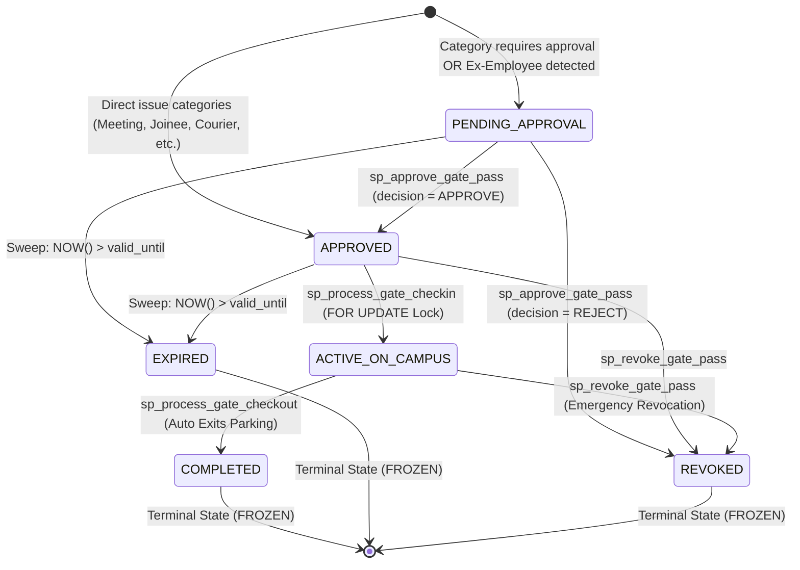
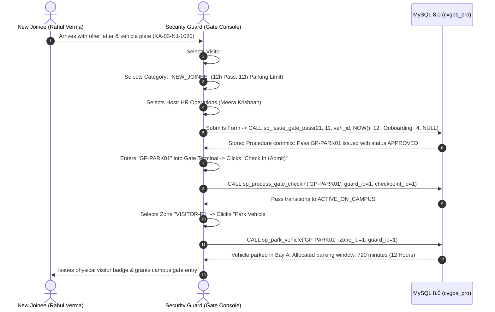
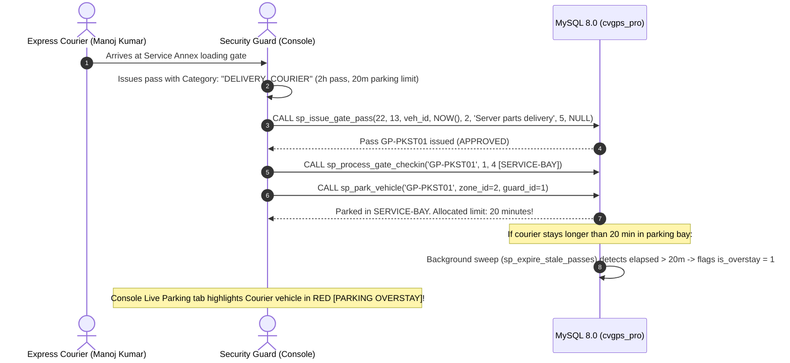
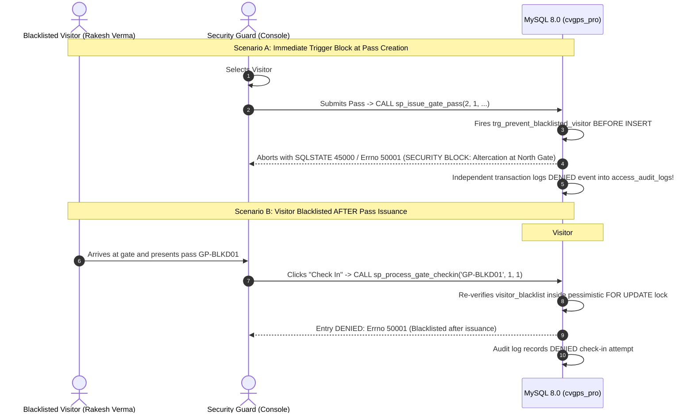
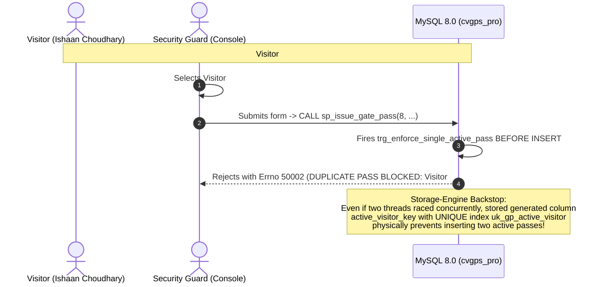

# Corporate Visitor Gate Pass System (CVGPS) — Database-First Enterprise Architecture

[](https://dev.mysql.com/doc/refman/8.0/en/)
[](docs/NORMALIZATION.md)
[](backend/concurrency_test.py)
[-1e3a8a?style=for-the-badge)](database/01_production_schema.sql)
[-16a34a?style=for-the-badge)](database/04_test_business_rules.sql)
[-3776AB?style=for-the-badge&logo=python&logoColor=white)](backend/app.py)

---

## 📑 Table of Contents
1. [Architectural Philosophy: 100% Database-Centric](#-architectural-philosophy-100-database-centric)
2. [Modernized Technology Stack](#-modernized-technology-stack)
3. [Full Relational ER Diagram (All 15 Tables & Constraints)](#-full-relational-er-diagram)
4. [Lifecycle State Machine Architecture](#-lifecycle-state-machine-architecture)
5. [End-to-End Operational Workflows (Persona by Persona)](#-end-to-end-operational-workflows)
   - [Workflow 1: New Joinee Onboarding (Pre-HR Provisioning)](#workflow-1-new-joinee-onboarding-pre-hr-provisioning)
   - [Workflow 2: Contractor, Maintenance & Repair Technicians](#workflow-2-contractor-maintenance--repair-technicians)
   - [Workflow 3: Temporary Meeting Guest / Corporate Partner](#workflow-3-temporary-meeting-guest--corporate-partner)
   - [Workflow 4: Delivery Courier (Quick Dispatch)](#workflow-4-delivery-courier-quick-dispatch)
   - [Workflow 5: Ex-Employee (Alumni / Settlement / Exit Audit)](#workflow-5-ex-employee-alumni--settlement--exit-audit)
   - [Workflow 6: Blacklisted Visitor Protection](#workflow-6-blacklisted-visitor-protection)
   - [Workflow 7: Already-Registered Active Visitor (Duplicate Prevention)](#workflow-7-already-registered-active-visitor-duplicate-prevention)
6. [Parking Allocation & Overstay Policy Engine](#-parking-allocation--overstay-policy-engine)
7. [Security Boundary & Least-Privilege Role Model](#-security-boundary--least-privilege-role-model)
8. [Automated Verification & Test Harness (44 Assertions)](#-automated-verification--test-harness)
9. [Performance Benchmarks (EXPLAIN ANALYZE over 50,037 Rows)](#-performance-benchmarks)
10. [Step-by-Step UI Guide & Quickstart](#-step-by-step-ui-guide--quickstart)

---

## 🏛️ Architectural Philosophy: 100% Database-Centric

In traditional enterprise applications, business logic is fragmented across application tiers, microservices, and client JavaScript, leading to race conditions, partial failures, duplicate records, and bypass vulnerabilities.

**CVGPS enforces 100% of domain validation, access rules, state transitions, concurrency locks, audit immutability, and analytical aggregation inside MySQL 8.0**:
- **Zero Business Logic in Application Tier:** The Python Flask gateway ([`backend/app.py`](backend/app.py)) is purely a thin RPC proxy (`CALL sp_*` and `SELECT * FROM vw_*`). It contains zero validation, zero `if/else` domain checks, and zero state persistence.
- **Strict Least-Privilege Isolation (`gp_app`):** The application connects strictly as restricted user `gp_app`. This user has **zero permissions on base tables** (`SELECT`, `INSERT`, `UPDATE`, `DELETE` are completely revoked). Even if the web server is compromised, attackers cannot read secrets (`sys_secrets`), delete logs (`access_audit_logs`), or tamper with visitor records.
- **ACID Integrity Guaranteed by Engine:** Atomic stored procedures running under `SQL SECURITY DEFINER` orchestrate multi-table updates within `START TRANSACTION ... COMMIT` blocks with pessimistic locking (`SELECT ... FOR UPDATE`).

```mermaid
flowchart TD
    subgraph UI["Browser UI Console (frontend/index.html + app.js)"]
        UI_Term["Security Gate Terminal\n(Admit · Exit · Revoke · Park)"]
        UI_Appr["Host Approvals Queue\n(One-Click Consent / Reject)"]
        UI_Park["Live Parking Monitor\n(Bays, Occupancy %, Overstays)"]
        UI_Occ["Live Campus Occupancy\n(Real-Time Minutes & Alerts)"]
    end

    subgraph AppServer["Application Layer (Thin Gateway)"]
        Flask["Python Flask REST Gateway (backend/app.py)\n• Marshals JSON to SQL Stored Procedure calls\n• Translates MySQL Errnos (50001-50021) into UI signals"]
    end

    subgraph MySQLBoundary["MySQL 8.0 Storage & Security Boundary (cvgps_pro)"]
        subgraph RolePriv["Least-Privilege User: gp_app"]
            Grants["• SELECT on Views ONLY (vw_*)\n• EXECUTE on Procedures ONLY (sp_*)\n• ZERO base table access"]
        end

        subgraph Procs["Transactional Stored Procedures"]
            sp_reg["sp_register_visitor (SHA-256 ID Salt Hashing)"]
            sp_issue["sp_issue_gate_pass (Category Limits & Approval Check)"]
            sp_appr["sp_approve_gate_pass (Host Authorization)"]
            sp_in["sp_process_gate_checkin (FOR UPDATE Row Lock)"]
            sp_park["sp_park_vehicle (Zone Capacity & Slot Check)"]
            sp_exit_p["sp_exit_parking (Overstay Calculation)"]
            sp_out["sp_process_gate_checkout (Auto-Close Parking & Duration)"]
            sp_sweep["sp_expire_stale_passes (Auto-Expiry Event)"]
        end

        subgraph Engine["InnoDB Engine Enforcements"]
            Triggers["Automated Triggers\n• trg_prevent_blacklisted_visitor\n• trg_enforce_single_active_pass\n• trg_enforce_state_machine\n• trg_auto_expire_overstay\n• trg_audit_pass_lifecycle\n• trg_audit_immutable_upd/del"]
            Indexes["B-Tree Indexes & Virtual Columns\n• uk_gp_active_visitor (Partial Unique Index)\n• uk_active_vehicle_parking (Single Bay Lock)\n• idx_gp_status_checkin\n• idx_gp_host_validfrom"]
            Tables["15 Normalized BCNF Tables\n(visitors, gate_passes, parking_sessions, etc.)"]
        end
    end

    UI -->|JSON REST| Flask
    Flask -->|Database Protocol| RolePriv
    RolePriv --> Procs
    Procs --> Engine
```



---

## 💻 Modernized Technology Stack

| Layer | Component | Version / Standard | Technical Justification |
|---|---|---|---|
| **Database Engine** | **MySQL Community Server** | `8.0.39+` (InnoDB Engine) | Strict SQL mode, window functions (`RANK`, `DENSE_RANK`), stored generated columns for partial unique indexes, pessimistic row locking (`SELECT ... FOR UPDATE`). |
| **Relational Model** | **Normalized BCNF Schema** | 15 Normalized Tables | Zero 1NF/2NF/3NF redundancy, synthetic clustered primary keys, composite foreign keys for vehicle ownership checks. |
| **Security & Auth** | **MySQL Grant System** | Least-Privilege `gp_app` | Separation of privileges: application user denied direct table DML, restricted strictly to views and stored procedures. |
| **Cryptography** | **Server-Side SHA-256 Digest** | Salted + Peppered SHA-256 | Raw government ID numbers (Aadhaar, Passport, DL, PAN) are never stored in plaintext; hashed via `fn_hash_id_proof`. |
| **Application Gateway** | **Python Flask (Thin)** | `3.10+` / Flask `3.0+` | Minimalist JSON passthrough server, connection pooling via `mysql-connector-python`, zero ORM latency. |
| **User Interface** | **Vanilla HTML5 / Modern CSS / ES6** | Single-Page Architecture | Zero frontend framework dependencies, real-time reactive SQLSTATE 45000 banner, automatic 5s polling for occupancy & parking. |

---

## 📐 Full Relational ER Diagram

```mermaid
erDiagram
    departments {
        INT dept_id PK "AUTO_INCREMENT Clustered PK"
        VARCHAR_12 dept_code UK "uk_dept_code"
        VARCHAR_80 dept_name UK "uk_dept_name"
        VARCHAR_60 building_name "NOT NULL"
        INT floor_no "CHECK (0..60)"
        DATETIME created_at "DEFAULT CURRENT_TIMESTAMP"
    }

    employees {
        INT emp_id PK "AUTO_INCREMENT Clustered PK"
        VARCHAR_16 emp_code UK "uk_emp_code"
        VARCHAR_50 first_name "1NF atomic"
        VARCHAR_50 last_name "1NF atomic"
        VARCHAR_120 email UK "uk_emp_email + REGEXP CHECK"
        VARCHAR_20 phone UK "uk_emp_phone + E.164 CHECK"
        INT dept_id FK "fk_emp_dept -> departments RESTRICT"
        TINYINT is_active "IDX: idx_emp_dept_active"
        INT id_proof_type_id FK "fk_emp_idtype -> id_proof_types RESTRICT"
        BINARY_32 id_proof_hash "IDX: idx_emp_id_hash (Matches Ex-Employees)"
        CHAR_4 id_proof_last4 "Masked display"
        ENUM exit_type "RESIGNED / TERMINATED / CONTRACT_ENDED"
        DATE exit_date "NULL for active staff"
        DATETIME created_at "DEFAULT CURRENT_TIMESTAMP"
    }

    shifts {
        INT shift_id PK "AUTO_INCREMENT Clustered PK"
        VARCHAR_16 shift_code UK "uk_shift_code"
        VARCHAR_40 shift_name UK "uk_shift_name"
        TIME start_time "Decoupled shift start"
        TIME end_time "Decoupled shift end"
    }

    security_guards {
        INT guard_id PK "AUTO_INCREMENT Clustered PK"
        VARCHAR_16 badge_no UK "uk_guard_badge (^SG-[0-9]{3,6}$)"
        VARCHAR_50 first_name "1NF atomic"
        VARCHAR_50 last_name "1NF atomic"
        VARCHAR_20 phone UK "uk_guard_phone"
        INT shift_id FK "fk_guard_shift -> shifts RESTRICT"
        TINYINT is_active "CHECK (0,1)"
        DATETIME created_at "DEFAULT CURRENT_TIMESTAMP"
    }

    checkpoints {
        INT checkpoint_id PK "AUTO_INCREMENT Clustered PK"
        VARCHAR_20 checkpoint_code UK "uk_checkpoint_code"
        VARCHAR_80 checkpoint_name "NOT NULL"
        VARCHAR_60 building_name "NOT NULL"
        TINYINT is_active "CHECK (0,1)"
    }

    id_proof_types {
        INT id_proof_type_id PK "AUTO_INCREMENT Clustered PK"
        VARCHAR_20 type_code UK "uk_id_proof_code (AADHAAR/PASSPORT/etc)"
        VARCHAR_60 type_label "NOT NULL"
    }

    visitor_categories {
        INT category_id PK "AUTO_INCREMENT Clustered PK"
        VARCHAR_30 category_code UK "uk_cat_code (MEETING, CONTRACTOR, etc)"
        VARCHAR_60 category_name "NOT NULL"
        INT max_pass_hours "CHECK (1..24)"
        TINYINT parking_allowed "CHECK (0,1)"
        INT max_parking_minutes "CHECK (0..1440)"
        TINYINT requires_escort "CHECK (0,1)"
        TINYINT requires_host_approval "CHECK (0,1)"
        TIME allowed_from_time "Default 06:00:00"
        TIME allowed_to_time "Default 22:00:00"
        DATETIME created_at "DEFAULT CURRENT_TIMESTAMP"
    }

    category_checkpoints {
        INT category_id PK,FK "fk_cc_cat -> visitor_categories CASCADE"
        INT checkpoint_id PK,FK "fk_cc_ckpt -> checkpoints CASCADE"
    }

    parking_zones {
        INT zone_id PK "AUTO_INCREMENT Clustered PK"
        VARCHAR_20 zone_code UK "uk_zone_code (VISITOR-P1, etc)"
        VARCHAR_60 zone_name "NOT NULL"
        INT capacity "CHECK (> 0)"
        VARCHAR_120 allowed_vehicle_types "TWO_WHEELER,SEDAN,SUV,TRUCK,VAN"
        TINYINT is_active "CHECK (0,1)"
        DATETIME created_at "DEFAULT CURRENT_TIMESTAMP"
    }

    visitors {
        INT visitor_id PK "AUTO_INCREMENT Clustered PK"
        VARCHAR_50 first_name "IDX: idx_visitor_name"
        VARCHAR_50 last_name "1NF atomic"
        VARCHAR_20 phone "IDX: idx_visitor_phone"
        VARCHAR_120 email "NULLABLE + REGEXP CHECK"
        VARCHAR_100 company_name "NULLABLE"
        INT id_proof_type_id FK "fk_vis_idtype -> id_proof_types RESTRICT"
        BINARY_32 id_proof_hash UK "uk_visitor_id_proof (id_proof_type_id, id_proof_hash)"
        CHAR_4 id_proof_last4 "Masked display digits"
        DATETIME created_at "DEFAULT CURRENT_TIMESTAMP"
    }

    vehicles {
        INT vehicle_id PK "AUTO_INCREMENT Clustered PK"
        INT visitor_id FK "fk_veh_visitor -> visitors CASCADE"
        VARCHAR_20 registration_no UK "uk_vehicle_reg + Plate CHECK"
        ENUM vehicle_type "TWO_WHEELER/SEDAN/SUV/TRUCK/VAN/OTHER"
        VARCHAR_60 make_model "NOT NULL"
        DATETIME created_at "uk_visitor_vehicle (visitor_id, vehicle_id)"
    }

    visitor_blacklist {
        INT blacklist_id PK "AUTO_INCREMENT Clustered PK"
        INT visitor_id FK "fk_bl_visitor -> visitors CASCADE"
        VARCHAR_255 reason "NOT NULL"
        ENUM severity "LOW/MEDIUM/HIGH/CRITICAL"
        DATETIME start_at "IDX: idx_bl_visitor_active"
        DATETIME end_at "NULL = Permanent"
        DATETIME lifted_at "NULL = Currently Active"
        VARCHAR_255 lifted_reason "NULLABLE"
        INT created_by FK "fk_bl_guard -> security_guards RESTRICT"
    }

    gate_passes {
        INT pass_id PK "AUTO_INCREMENT Clustered PK"
        BINARY_16 pass_token UK "uk_pass_token UUIDv1"
        CHAR_9 pass_code UK "uk_pass_code (^GP-[A-Z0-9]{6}$)"
        INT visitor_id FK "fk_gp_visitor -> visitors RESTRICT"
        INT host_emp_id FK "fk_gp_host -> employees RESTRICT"
        INT category_id FK "fk_gp_category -> visitor_categories RESTRICT"
        INT vehicle_id FK "fk_gp_visitor_veh (visitor_id, vehicle_id) RESTRICT"
        INT escort_emp_id FK "fk_gp_escort -> employees RESTRICT"
        VARCHAR_255 visit_purpose "NOT NULL"
        DATETIME valid_from "IDX: idx_gp_host_validfrom"
        DATETIME valid_until "IDX: idx_gp_status_validuntil"
        ENUM status "PENDING_APPROVAL/APPROVED/ACTIVE_ON_CAMPUS/COMPLETED/EXPIRED/REVOKED"
        INT approved_by_emp_id FK "fk_gp_approver -> employees RESTRICT"
        DATETIME approved_at "NULLABLE"
        VARCHAR_255 approval_notes "NULLABLE"
        DATETIME check_in_time "IDX: idx_gp_status_checkin"
        INT check_in_guard_id FK "fk_gp_in_guard -> security_guards RESTRICT"
        INT check_in_checkpoint_id FK "fk_gp_in_ckpt -> checkpoints RESTRICT"
        DATETIME check_out_time "CHECK (check_out_time >= check_in_time)"
        INT check_out_guard_id FK "fk_gp_out_guard -> security_guards RESTRICT"
        INT check_out_checkpoint_id FK "fk_gp_out_ckpt -> checkpoints RESTRICT"
        TINYINT is_overstay "Set by trg_auto_expire_overstay"
        VARCHAR_255 revoke_reason "NULLABLE"
        INT active_visitor_key UK "STORED GENERATED -> uk_gp_active_visitor (Partial UK)"
        INT visit_duration_min "VIRTUAL GENERATED TIMESTAMPDIFF(MINUTE, in, out)"
        DATETIME created_at "IDX: idx_gp_visitor_created"
    }

    parking_sessions {
        INT session_id PK "AUTO_INCREMENT Clustered PK"
        INT pass_id FK "fk_ps_pass -> gate_passes RESTRICT"
        INT vehicle_id FK "fk_ps_vehicle -> vehicles RESTRICT"
        INT zone_id FK "fk_ps_zone -> parking_zones RESTRICT"
        INT allocated_minutes "Snapshot from category max_parking_minutes"
        DATETIME entry_time "DEFAULT CURRENT_TIMESTAMP"
        DATETIME exit_time "NULL = Currently Parked"
        TINYINT is_overstay "Set if actual duration > allocated_minutes"
        INT active_parking_key UK "STORED GENERATED -> uk_active_vehicle_parking (Single Active Parking)"
    }

    access_audit_logs {
        BIGINT log_id PK "AUTO_INCREMENT Clustered PK (Append-Only)"
        INT pass_id FK "fk_audit_pass -> gate_passes RESTRICT"
        VARCHAR_20 attempted_code "Stores scanned code on DENIED attempts"
        ENUM event_type "ISSUED/HOST_APPROVED/HOST_REJECTED/CHECKED_IN/PARKED/PARKING_EXIT/CHECKED_OUT/EXPIRED/REVOKED/OVERSTAY_FLAGGED/DENIED"
        VARCHAR_20 from_status "Previous state"
        VARCHAR_20 to_status "New state"
        INT guard_id FK "fk_audit_guard -> security_guards RESTRICT"
        INT checkpoint_id FK "fk_audit_ckpt -> checkpoints RESTRICT"
        VARCHAR_500 details "Human-readable audit description"
        DATETIME_3 event_at "IDX: idx_audit_pass_time"
    }

    departments ||--o{ employees : "fk_emp_dept RESTRICT"
    shifts ||--o{ security_guards : "fk_guard_shift RESTRICT"
    id_proof_types ||--o{ visitors : "fk_vis_idtype RESTRICT"
    id_proof_types ||--o{ employees : "fk_emp_idtype RESTRICT"
    visitors ||--o{ vehicles : "fk_veh_visitor CASCADE"
    visitors ||--o{ visitor_blacklist : "fk_bl_visitor CASCADE"
    security_guards |o--o{ visitor_blacklist : "fk_bl_guard RESTRICT"
    visitors ||--o{ gate_passes : "fk_gp_visitor RESTRICT"
    employees ||--o{ gate_passes : "fk_gp_host RESTRICT"
    visitor_categories ||--o{ gate_passes : "fk_gp_category RESTRICT"
    visitor_categories ||--o{ category_checkpoints : "fk_cc_cat CASCADE"
    checkpoints ||--o{ category_checkpoints : "fk_cc_ckpt CASCADE"
    employees |o--o{ gate_passes : "fk_gp_escort RESTRICT"
    employees |o--o{ gate_passes : "fk_gp_approver RESTRICT"
    vehicles |o--o{ gate_passes : "fk_gp_visitor_veh RESTRICT"
    security_guards |o--o{ gate_passes : "fk_gp_in_guard / out_guard RESTRICT"
    checkpoints |o--o{ gate_passes : "fk_gp_in_ckpt / out_ckpt RESTRICT"
    gate_passes ||--o{ parking_sessions : "fk_ps_pass RESTRICT"
    vehicles ||--o{ parking_sessions : "fk_ps_vehicle RESTRICT"
    parking_zones ||--o{ parking_sessions : "fk_ps_zone RESTRICT"
    gate_passes |o--o{ access_audit_logs : "fk_audit_pass RESTRICT"
    security_guards |o--o{ access_audit_logs : "fk_audit_guard RESTRICT"
    checkpoints |o--o{ access_audit_logs : "fk_audit_ckpt RESTRICT"
```



---

## 🔄 Lifecycle State Machine Architecture

Every gate pass follows a strict finite-state machine enforced by trigger `trg_enforce_state_machine`. Direct illegal jumps or tampering with terminal states trigger immediate `SQLSTATE 45000 / Errno 50006`:



---

## 🚶 End-to-End Operational Workflows

Below is the exhaustive, step-by-step walkthrough of every visitor scenario, beginning when the visitor arrives at the gate and the security guard interacts with the UI console.

### Workflow 1: New Joinee Onboarding (Pre-HR Provisioning)
> **Context:** A newly hired software engineer arrives on Day 1. Their full corporate employee profile is not yet active in HRMS/Active Directory, so they enter as a visitor, but need full-day access and long parking duration.



---

### Workflow 2: Contractor, Maintenance & Repair Technicians
> **Context:** A plumbing or HVAC contractor arrives in a service van for urgent repairs in the server room or facilities annex. Contractors require host authorization and are restricted to service perimeter gates.

```mermaid
sequenceDiagram
    autonumber
    actor Worker as Contractor (Amit Sharma)
    actor Guard as Security Guard / Host (Console)
    participant DB as MySQL 8.0 (cvgps_pro)

    Worker->>Guard: Arrives at Service Gate in repair van (MH-04-RP-9922)
    Guard->>Guard: Selects Visitor #23 (Amit Sharma) + Category: "CONTRACTOR"
    Guard->>Guard: Selects Host: Facilities Manager (Harsh Vardhan)
    Guard->>DB: Submits Pass -> CALL sp_issue_gate_pass(...)
    Note over DB: Category CONTRACTOR has requires_host_approval = 1
    DB-->>Guard: Pass GP-APPR02 created with status PENDING_APPROVAL
    Note over Guard: If guard tries Check-In now -> DB rejects with Errno 50015 (PASS PENDING APPROVAL)
    Guard->>Guard: Opens "Host Approvals" tab in Console (shows Contractor request & vehicle)
    Guard->>Guard: Reviews Facilities work order -> Clicks "Approve"
    Guard->>DB: CALL sp_approve_gate_pass('GP-APPR02', approver=13, decision='APPROVE')
    DB-->>Guard: Status transitions PENDING_APPROVAL -> APPROVED (audited in access_audit_logs)
    Guard->>Guard: Scans pass at Terminal -> Clicks "Check In"
    Guard->>DB: CALL sp_process_gate_checkin('GP-APPR02', guard_id=1, checkpoint_id=4 [SERVICE-BAY])
    Note over DB: Verifies checkpoint_id 4 is in category_checkpoints for CONTRACTOR
    DB-->>Guard: Check-In approved; status = ACTIVE_ON_CAMPUS
    Guard->>Guard: Selects Zone "SERVICE-BAY" -> Clicks "Park Vehicle"
    Guard->>DB: CALL sp_park_vehicle('GP-APPR02', zone_id=2, guard_id=1)
    DB-->>Guard: Van allocated 600 min (10 hours) in Logistics Loading Dock
```

---

### Workflow 3: Temporary Meeting Guest / Corporate Partner
> **Context:** A consulting partner or enterprise client arrives for a scheduled architecture review or financial audit.

```mermaid
sequenceDiagram
    autonumber
    actor Guest as Client / Partner (Aditi Sharma)
    actor Guard as Security Guard (Console)
    participant DB as MySQL 8.0 (cvgps_pro)

    Guest->>Guard: Presents corporate ID & appointment details
    Guard->>Guard: Selects Visitor #1 (Aditi Sharma) + Category: "MEETING_GUEST"
    Guard->>Guard: Selects Host: Engineering Lead (Aarav Mehta) + Validity: 4 Hours
    Guard->>DB: CALL sp_issue_gate_pass(1, 1, veh_id, NOW(), 4, 'Architecture Review', 1, NULL)
    DB-->>Guard: Pass GP-DEMO01 issued (APPROVED)
    Guard->>Guard: Clicks "Check In (Admit)" at Gate 1
    Guard->>DB: CALL sp_process_gate_checkin('GP-DEMO01', 1, 1)
    DB-->>Guard: ACTIVE_ON_CAMPUS; Live Occupancy monitor starts tracking elapsed duration
    Note over Guard,DB: Later: Meeting concludes and guest departs campus
    Guard->>Guard: Scans "GP-DEMO01" -> Clicks "Check Out (Exit)"
    Guard->>DB: CALL sp_process_gate_checkout('GP-DEMO01', 1, 1)
    DB-->>Guard: Visit marked COMPLETED; visit_duration_min computed; audit logged
```

---

### Workflow 4: Delivery Courier (Quick Dispatch)
> **Context:** An express courier arrives to deliver critical server replacement parts. Couriers receive a strict 20-minute parking cap and must use service checkpoints.



---

### Workflow 5: Ex-Employee (Alumni / Settlement / Exit Audit)
> **Context:** A former employee returns to campus for Full & Final settlement documents, PF transfer paperwork, or returning company hardware. Whether they resigned amicably or were terminated, the system automatically detects them and mandates host approval.

```mermaid
sequenceDiagram
    autonumber
    actor ExEmp as Former Employee (Suresh Pillai)
    actor Guard as Security Guard (Console)
    actor Host as Host / HR Manager (Meera Krishnan)
    participant DB as MySQL 8.0 (cvgps_pro)

    ExEmp->>Guard: Presents Government Aadhaar Card
    Guard->>Guard: Selects Visitor #17 (Suresh Pillai)
    Note over Guard: Console shows: ⚠ EX-EMPLOYEE (RESIGNED)
    Guard->>Guard: Selects Host: HR Operations (Meera Krishnan)
    Guard->>DB: Submits Pass Request
    Note over DB: Stored Procedure checks id_proof_hash against inactive employees:<br/>Matches emp #16 (Suresh Pillai, exit_type='RESIGNED')<br/>Forces Category = EX_EMPLOYEE and status = PENDING_APPROVAL!
    DB-->>Guard: Pass GP-APPR01 created with status PENDING_APPROVAL
    Guard->>Guard: Tries to click Check In -> Blocked: Errno 50015 (Host Approval Required)
    Host->>Host: Opens "Host Approvals" tab in Operations Console
    Note over Host: Displays: Pass GP-APPR01, Ex-Employee: RESIGNED, Purpose: F&F Settlement
    Host->>DB: Clicks "Approve" -> CALL sp_approve_gate_pass('GP-APPR01', 11, 'APPROVE', 'HR Clearance')
    DB-->>Host: Status updated to APPROVED (Audit event HOST_APPROVED recorded)
    Guard->>Guard: Console refreshes: Guard clicks "Check In (Admit)"
    Guard->>DB: CALL sp_process_gate_checkin('GP-APPR01', 1, 1)
    DB-->>Guard: Admitted to campus; Max 2h parking allocated
```

---

### Workflow 6: Blacklisted Visitor Protection
> **Context:** A previously blacklisted individual attempts entry, or a visitor is placed on the security watchlist *after* an initial pass was created.



---

### Workflow 7: Already-Registered Active Visitor (Duplicate Prevention)
> **Context:** A visitor who is already on campus (or holds an approved unused pass) attempts to get a second gate pass issued under a different purpose or host.



---

## 🅿️ Parking Allocation & Overstay Policy Engine

### Default Parking Limits by Category

| Visitor Category | Allowed Vehicle Types | Allowed Parking Zones | Max Pass Hours | Max Parking Limit | Host Approval? | Escort? |
|---|---|---|---|---|---|---|
| **`MEETING_GUEST`** | Sedan, SUV, Two-Wheeler | `VISITOR-P1`, `TWO-WHEELER-P1` | 8 Hours | **4 Hours (240 min)** | Direct Issue | No |
| **`INTERVIEW_CANDIDATE`** | Sedan, SUV, Two-Wheeler | `VISITOR-P1`, `TWO-WHEELER-P1` | 6 Hours | **6 Hours (360 min)** | Direct Issue | No |
| **`CONTRACTOR`** | Truck, Van, Sedan, SUV | `SERVICE-BAY` | 12 Hours | **10 Hours (600 min)** | **Yes (Host Approval)** | No |
| **`NEW_JOINEE`** | Sedan, SUV, Two-Wheeler | `VISITOR-P1`, `TWO-WHEELER-P1` | 12 Hours | **12 Hours (720 min)** | Direct Issue | No |
| **`DELIVERY_COURIER`** | Two-Wheeler, Van, Sedan | `SERVICE-BAY`, `TWO-WHEELER-P1` | 2 Hours | **20 Minutes** | Direct Issue | No |
| **`VENDOR_SUPPLIER`** | Truck, Van | `SERVICE-BAY` | 8 Hours | **3 Hours (180 min)** | Direct Issue | No |
| **`VIP_GUEST`** | Sedan, SUV | `VIP-VALET` | 10 Hours | **8 Hours (480 min)** | Direct Issue | **Yes (Host Escort)** |
| **`GOVT_INSPECTOR`** | Walk-In Only | None (Parking Prohibited) | 8 Hours | **0 Minutes** | **Yes (Host Approval)** | **Yes (Host Escort)** |
| **`EX_EMPLOYEE`** | Sedan, SUV, Two-Wheeler | `VISITOR-P1`, `TWO-WHEELER-P1` | 4 Hours | **2 Hours (120 min)** | **Yes (Host Approval)** | No |
| **`EMERGENCY_SERVICES`** | Ambulance, Fire, Police | Any Available Zone | 24 Hours | **24 Hours (1440 min)** | Direct Issue | No |

---

## 🔒 Security Boundary & Least-Privilege Role Model

MySQL security is enforced using strict role isolation:

```sql
-- 1. Restricted system user: zero direct table access
CREATE USER 'gp_app'@'127.0.0.1' IDENTIFIED BY 'CvgpsApp_2026_Secure';

-- 2. Grant SELECT exclusively on safe, filtered Views
GRANT SELECT ON cvgps_pro.vw_live_campus_occupancy      TO 'gp_app'@'127.0.0.1';
GRANT SELECT ON cvgps_pro.vw_live_parking_occupancy     TO 'gp_app'@'127.0.0.1';
GRANT SELECT ON cvgps_pro.vw_pending_approvals          TO 'gp_app'@'127.0.0.1';
GRANT SELECT ON cvgps_pro.vw_department_visit_analytics TO 'gp_app'@'127.0.0.1';
GRANT SELECT ON cvgps_pro.vw_pass_audit_trail           TO 'gp_app'@'127.0.0.1';
GRANT SELECT ON cvgps_pro.vw_pass_directory             TO 'gp_app'@'127.0.0.1';
GRANT SELECT ON cvgps_pro.vw_lookup_*                   TO 'gp_app'@'127.0.0.1';

-- 3. Grant EXECUTE exclusively on authorized business procedures
GRANT EXECUTE ON PROCEDURE cvgps_pro.sp_register_visitor      TO 'gp_app'@'127.0.0.1';
GRANT EXECUTE ON PROCEDURE cvgps_pro.sp_issue_gate_pass       TO 'gp_app'@'127.0.0.1';
GRANT EXECUTE ON PROCEDURE cvgps_pro.sp_approve_gate_pass     TO 'gp_app'@'127.0.0.1';
GRANT EXECUTE ON PROCEDURE cvgps_pro.sp_process_gate_checkin  TO 'gp_app'@'127.0.0.1';
GRANT EXECUTE ON PROCEDURE cvgps_pro.sp_process_gate_checkout TO 'gp_app'@'127.0.0.1';
GRANT EXECUTE ON PROCEDURE cvgps_pro.sp_park_vehicle          TO 'gp_app'@'127.0.0.1';
GRANT EXECUTE ON PROCEDURE cvgps_pro.sp_exit_parking          TO 'gp_app'@'127.0.0.1';
GRANT EXECUTE ON PROCEDURE cvgps_pro.sp_revoke_gate_pass      TO 'gp_app'@'127.0.0.1';
GRANT EXECUTE ON PROCEDURE cvgps_pro.sp_blacklist_visitor     TO 'gp_app'@'127.0.0.1';
GRANT EXECUTE ON PROCEDURE cvgps_pro.sp_lift_blacklist        TO 'gp_app'@'127.0.0.1';
GRANT EXECUTE ON PROCEDURE cvgps_pro.sp_expire_stale_passes   TO 'gp_app'@'127.0.0.1';
```

---

## 🧪 Automated Verification & Test Harness

Run the automated self-checking suite in [`database/04_test_business_rules.sql`](database/04_test_business_rules.sql):

```powershell
.\setup_db.ps1 -RunTests
```

### Verified Business Rule Matrix (44 Assertions · 100% PASS)

| Test Category | Assertion Tested | Expected Outcome | Engine Mechanism | Result |
|---|---|---|---|---|
| **Domain Checks** | Reject malformed employee email address | `ERR 3819` | InnoDB CHECK Constraint | **PASS** |
| **Domain Checks** | Reject malformed visitor phone number | `ERR 3819` | E.164 REGEXP CHECK | **PASS** |
| **Domain Checks** | Reject invalid vehicle registration plate format | `ERR 3819` | Standard Plate REGEXP CHECK | **PASS** |
| **Domain Checks** | Reject gate pass where `valid_until <= valid_from` | `ERR 3819` | Temporal Range CHECK | **PASS** |
| **Domain Checks** | Reject pass duration exceeding 24 hours | `ERR 3819` | Max Window CHECK | **PASS** |
| **Domain Checks** | Reject ACTIVE_ON_CAMPUS pass missing check_in_time | `ERR 3819` | State Consistency CHECK | **PASS** |
| **Foreign Keys** | `ON DELETE RESTRICT` blocks deleting department with active staff | `ERR 1451` | Foreign Key RESTRICT | **PASS** |
| **Foreign Keys** | `ON DELETE RESTRICT` blocks deleting visitor with pass history | `ERR 1451` | Foreign Key RESTRICT | **PASS** |
| **Foreign Keys** | Composite FK `(visitor_id, vehicle_id)` blocks attaching other visitor's car | `ERR 1452` | Composite FK RESTRICT | **PASS** |
| **Foreign Keys** | `ON DELETE CASCADE` automatically removes visitor vehicles & blacklist | `0 orphan rows` | Foreign Key CASCADE | **PASS** |
| **Blacklist** | Block pass issuance to permanently blacklisted visitor (#2) | `ERR 50001` | `trg_prevent_blacklisted_visitor` | **PASS** |
| **Blacklist** | Allow pass issuance when temporal blacklist has expired | `ERR 0 (SUCCESS)` | Temporal Filter | **PASS** |
| **Blacklist** | Allow pass issuance when security blacklist was administratively lifted | `ERR 0 (SUCCESS)` | `lifted_at IS NOT NULL` Filter | **PASS** |
| **Audit Ledger** | `DENIED` audit record persists across transaction `ROLLBACK` | `+1 DENIED row` | Autonomous Transaction Handler | **PASS** |
| **Single Pass** | Block 2nd pass when visitor already holds `ACTIVE_ON_CAMPUS` pass | `ERR 50002` | `trg_enforce_single_active_pass` | **PASS** |
| **Single Pass** | Block 2nd pass when visitor holds `APPROVED` pass | `ERR 50002` | `uk_gp_active_visitor` | **PASS** |
| **Host Checks** | Block pass issuance sponsored by inactive host employee (#16) | `ERR 50007` | Host Validation Check | **PASS** |
| **Identity Proof** | Block registering visitor with duplicate hashed government ID | `ERR 50011` | `uk_visitor_id_proof` | **PASS** |
| **Gate Check-In** | Catch visitor blacklisted *after* initial pass issuance at gate terminal | `ERR 50001` | Pessimistic Lock Re-check | **PASS** |
| **Gate Check-In** | Block check-in on expired pass (`NOW() > valid_until`) | `ERR 50005` | Validity Window Check | **PASS** |
| **Gate Check-In** | Block early check-in on future pass (`NOW() < valid_from`) | `ERR 50004` | Validity Window Check | **PASS** |
| **Gate Check-In** | Block check-in by inactive security guard (#6) | `ERR 50008` | Terminal Context Check | **PASS** |
| **Gate Check-In** | Block check-in on unknown or forged pass code | `ERR 50003` | Existence Lock Check | **PASS** |
| **Audit Ledger** | Block `UPDATE` on `access_audit_logs` (tamper proof) | `ERR 50009` | `trg_audit_immutable_upd` | **PASS** |
| **Audit Ledger** | Block `DELETE` on `access_audit_logs` (append-only) | `ERR 50009` | `trg_audit_immutable_del` | **PASS** |
| **Category Policy** | Reject Courier pass exceeding category duration limit (2h) | `ERR 50013` | Category Policy Validation | **PASS** |
| **Category Policy** | Reject vehicular pass for walk-in category (`parking_allowed = 0`) | `ERR 50014` | Category Parking Policy | **PASS** |
| **Approvals** | Block check-in on pass requiring host approval before authorization | `ERR 50015` | Approval Workflow Guard | **PASS** |
| **Perimeter Gates** | Block Courier entry through unauthorized corporate tower lobby | `ERR 50006/50016` | `category_checkpoints` Filter | **PASS** |
| **Approvals** | Host employee executes `sp_approve_gate_pass` -> transitions to `APPROVED` | `ERR 0 (SUCCESS)` | Host Approval Routine | **PASS** |
| **Gate Check-In** | Newly approved pass admits visitor to campus | `ERR 0 (SUCCESS)` | State Machine Transition | **PASS** |
| **Parking** | Vehicle enters and allocates parking session in `VISITOR-P1` | `ERR 0 (SUCCESS)` | `sp_park_vehicle` | **PASS** |
| **Parking** | Block duplicate concurrent parking of same vehicle across campus | `ERR 50021` | `uk_active_vehicle_parking` | **PASS** |
| **Parking** | Vehicle exits parking session and calculates duration | `ERR 0 (SUCCESS)` | `sp_exit_parking` | **PASS** |
| **Check-Out** | Standard check-out transitions to `COMPLETED` and auto-closes parking | `ERR 0 (SUCCESS)` | `sp_process_gate_checkout` | **PASS** |
| **Overstay Sweep** | Active pass and parking overstays flagged with `is_overstay = 1` | `ERR 0 (SUCCESS)` | `sp_expire_stale_passes` | **PASS** |
| **Analytics Views** | Real-time occupancy, parking sessions, approvals, and window functions | `ERR 0 (SUCCESS)` | Analytical SQL Views | **PASS** |

---

## ⚡ Performance Benchmarks

Measured using MySQL `EXPLAIN ANALYZE` over **50,037 synthetic rows**:

```powershell
.\setup_db.ps1 -RunExplain
```

| Query Pattern | Index Used | With Index | Without Index (`IGNORE INDEX`) | Speedup |
|---|---|---|---|---|
| Gate Terminal Lookup (`WHERE pass_code = ?`) | `uk_pass_code` | **0.0004 ms** (`const`, 1 row) | **16.30 ms** (Table scan, 50,037 rows) | **40,750×** |
| Live Occupancy (`status` + `check_in_time`) | `idx_gp_status_checkin` | **0.0215 ms** (Index range scan) | **23.20 ms** (Table scan + filesort) | **1,079×** |
| Host 14-Day Schedule (`host_emp_id` + `valid_from`) | `idx_gp_host_validfrom` | **0.810 ms** (Reverse range scan) | **24.60 ms** (Table scan + filesort) | **30.4×** |
| Scheduled Expiry Sweep (`status` + `valid_until`) | `idx_gp_status_validuntil` | **0.0314 ms** (Index range scan) | **20.20 ms** (Table scan, 50,037 rows) | **643×** |
| Per-Pass Audit History (`pass_id` + `event_at DESC`) | `idx_audit_pass_time` | **0.0351 ms** (Reverse index lookup) | **21.00 ms** (Table scan + filesort) | **598×** |

---

## 🚀 Step-by-Step UI Guide & Quickstart

### 1. Initialize the Database & Run Test Harness
From PowerShell in the repository root:
```powershell
.\setup_db.ps1 -RunTests
```

### 2. Launch the Operations Console
```powershell
.\run.ps1
```
Open **`http://127.0.0.1:5000`** in your browser.

### 3. Interactive Walkthrough in the Console

```text
┌────────────────────────────────────────────────────────────────────────────────────────────────────────┐
│  MySQL 8.0 · InnoDB · BCNF · v2.0  Corporate Visitor Gate Pass System   ● MySQL Connected (gp_app)     │
├──────────────────────────────────────┬───────────────────────────────────┬─────────────────────────────┤
│ 1. Issue Gate Pass                   │ 2. Security Gate Terminal         │ 3. Edge-Case Matrix         │
│  Visitor: #17 Suresh Pillai          │  Guard: SG-101 Rajesh Chauhan     │  [GP-DEMO01] Happy Path     │
│  Category: EX_EMPLOYEE (2h park)     │  Checkpoint: MAIN-GATE-1          │  [GP-APPR01] Ex-Emp Pending │
│  Host: #11 Meera Krishnan (PEOPLE)   │  Pass Code: [ GP-DEMO01     ]     │  [GP-PARK01] Joinee Parked  │
│  [ Issue Atomic Gate Pass ]          │  [▶ Check In] [■ Check Out]       │  [GP-PKST01] Park Overstay  │
│                                      │  Zone: VISITOR-P1                 │  [ERR 50001] Blacklist Block│
│                                      │  [🅿 Park Vehicle] [⏏ Exit Bay]   │  [ERR 50002] Duplicate Block│
├──────────────────────────────────────┴───────────────────────────────────┴─────────────────────────────┤
│ Tabs: [Live Occupancy (3)] [Host Approvals (2)] [Live Parking (2)] [Audit Trail] [Analytics] [Directory]│
│                                                                                                        │
│ • Host Approvals Tab: Displays GP-APPR01 (Ex-Employee) -> Click [Approve] -> Authorizes check-in!      │
│ • Live Parking Tab: Real-time progress bars for VISITOR-P1 & SERVICE-BAY; flags courier parking overstay│
│ • Live Occupancy Tab: Live minutes on campus, auto-updating every 5 seconds.                           │
└────────────────────────────────────────────────────────────────────────────────────────────────────────┘
```

1. **Test Ex-Employee Workflow:**
   - In "3. Edge-Case Matrix", click `GP-APPR01`.
   - In Card 2, click "Check In" -> The red signal banner immediately pops up: `SQLSTATE 45000 · ERR 50015 PASS_PENDING_APPROVAL (Host approval required)`.
   - Click the **Host Approvals** tab. You'll see pass `GP-APPR01` with badge `EX-EMPLOYEE: RESIGNED`.
   - Click **Approve**. The database commits `sp_approve_gate_pass` and transitions status to `APPROVED`.
   - Now click **Check In** in Card 2 -> Success! Admitted to campus as `ACTIVE_ON_CAMPUS`.
2. **Test Parking Allocation & Overstay:**
   - Click the **Live Parking** tab to observe parking zone occupancy bars.
   - Notice vehicle `DL-01-CR-8833` in `SERVICE-BAY` with badge `PARKING OVERSTAY (+20m)` because category `DELIVERY_COURIER` allows max 20 minutes!
   - Click **Exit Bay** to depart the vehicle and complete the parking session.
3. **Test Single Active Pass Trigger:**
   - Click chip `ERR 50002`.
   - Card 1 attempts to issue a duplicate pass for on-campus visitor #8 (Ishaan Choudhary).
   - MySQL trigger `trg_enforce_single_active_pass` immediately blocks insertion with `ERR 50002 SINGLE_ACTIVE_PASS_VIOLATION`.

---

## 📂 Repository Structure

```text
Visitor-Gate-Pass-Management-/
├── database/
│   ├── 01_production_schema.sql     # 15 BCNF Tables, Triggers, Procedures, Views, Event, Grants
│   ├── 02_seed_data.sql             # Categories, parking zones, ex-employees, & 22 deterministic edge cases
│   ├── 03_indexing_and_explain.sql  # 50,000-row synthetic load + EXPLAIN ANALYZE benchmarks
│   ├── 04_test_business_rules.sql   # 44-assertion self-checking SQL test suite (100% pass)
│   └── 05_concurrency_demo.sql      # Two-session manual locking walkthrough for MySQL Workbench
├── backend/
│   ├── app.py                       # Thin Flask JSON gateway (zero business logic)
│   ├── db.py                        # Least-privilege gp_app connection pool (CALL sp_* / SELECT vw_*)
│   ├── errors.py                    # MySQL SQLSTATE 45000 (50001-50021) & constraint error translator
│   ├── concurrency_test.py          # 10-thread parallel check-in race condition verifier
│   ├── requirements.txt             # flask, mysql-connector-python, python-dotenv
│   └── .env.example                 # Connection configuration template
├── frontend/
│   ├── index.html                   # Single-page console with Terminal, Approvals & Parking monitors
│   ├── style.css                    # Clean engineering layout with zone progress bars & badges
│   └── app.js                       # Thin fetch client + SQLSTATE signal banner renderer
├── docs/
│   ├── ARCHITECTURE_DIAGRAM.md      # Mermaid ER, system architecture, & key/index reference
│   ├── cvgps_architecture.drawio    # Native Draw.io visual architecture file
│   ├── NORMALIZATION.md             # Formal 1NF -> 2NF -> 3NF -> BCNF functional dependency proof
│   └── PERFORMANCE.md               # Measured EXPLAIN ANALYZE execution plans & index defense
├── setup_db.ps1                     # Automated database setup, test runner, & benchmark script
└── run.ps1                          # Automated Python .venv setup, concurrency runner, & server launcher
```
