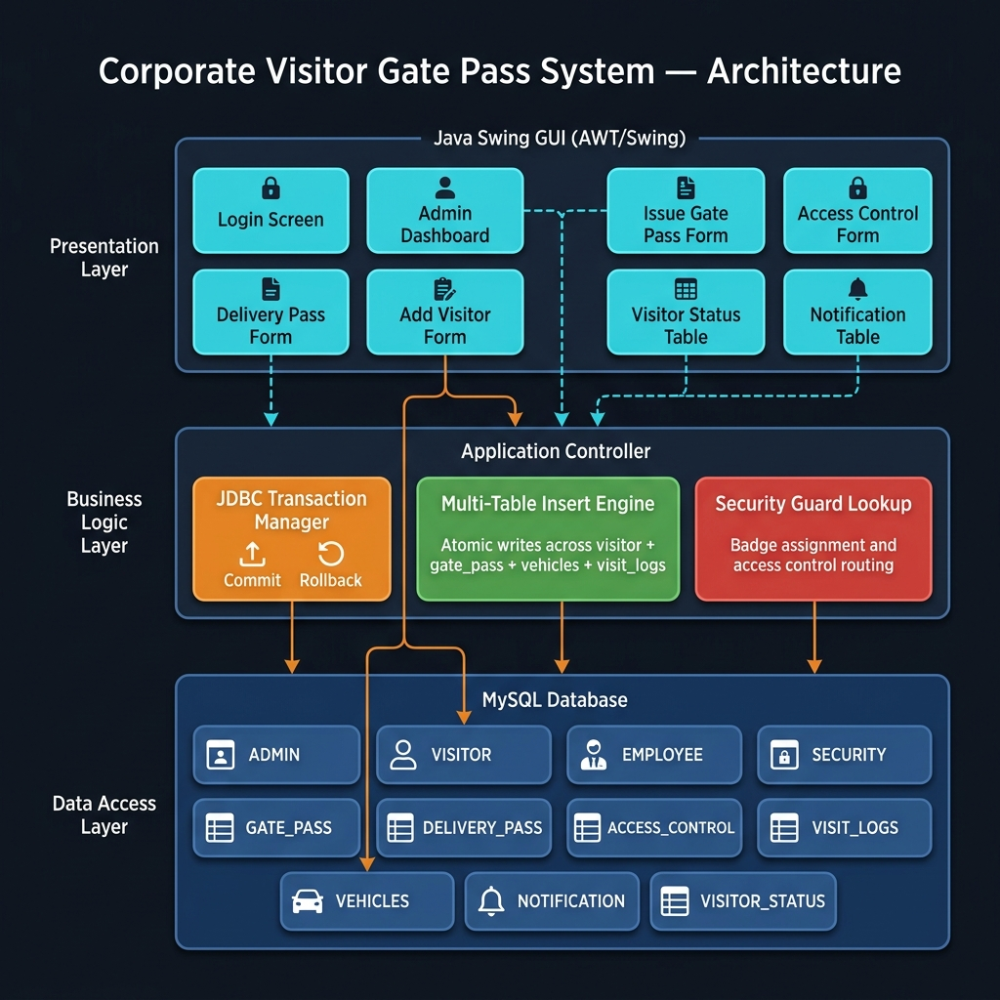
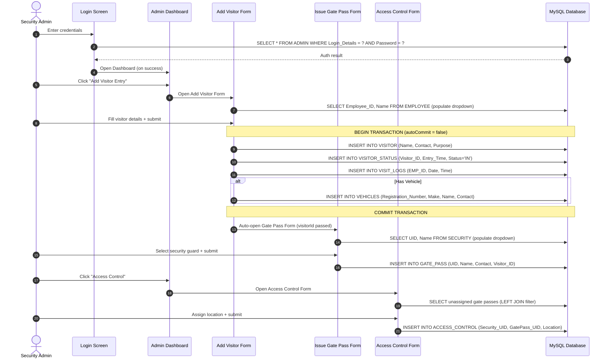

# Corporate Visitor Gate Pass System — JDBC Transactional Desktop Application

[](https://openjdk.org/)
[](https://www.mysql.com/)
[](https://docs.oracle.com/javase/tutorial/uiswing/)
[](https://docs.oracle.com/javase/tutorial/jdbc/)

---

## 📌 Problem Statement & Engineering Justification

Corporate campuses managing hundreds of daily visitors face a critical security gap: paper logbooks are untraceable, gate passes are manually issued without binding to security personnel, and there is no real-time visibility into which visitors are currently **inside** the facility. A breach in visitor tracking creates liability risks and fails physical security audits.

### The Solution: JDBC-Transactional Visitor Management
This system solves these challenges with a multi-screen Java Swing desktop application backed by MySQL:
- **Atomic Multi-Table Transactions**: Visitor registration atomically inserts across 4 tables (`VISITOR`, `VISITOR_STATUS`, `VISIT_LOGS`, `VEHICLES`) in a single JDBC transaction with `conn.setAutoCommit(false)` — ensuring either all records are committed or none are, preventing orphaned entries on partial failures.
- **Gate Pass ↔ Security Guard Binding**: Every gate pass is cryptographically linked to a specific security guard (`SECURITY.UID → GATE_PASS.UID`), creating an auditable chain of custody.
- **Real-Time Status Tracking**: The `VISITOR_STATUS` table maintains live `IN/OUT` state with entry/exit timestamps, enabling instant facility headcounts.
- **Access Control Enforcement**: After gate pass issuance, security assigns visitors to specific building locations via the `ACCESS_CONTROL` table — unassigned passes are filtered via `LEFT JOIN ... WHERE ac.GatePass_UID IS NULL`.

---

## 📐 System Architecture & Data Flow

### Application Architecture

<p align="center">
  
</p>

### Visitor Registration Lifecycle



---

## 🗄️ Database Schema (11 Tables)

| Table | Purpose | Key Relationships |
|---|---|---|
| `ADMIN` | Admin login credentials | — |
| `VISITOR` | Visitor identity records (name, contact, purpose) | → `VISITOR_STATUS`, `GATE_PASS` |
| `EMPLOYEE` | Corporate employees responsible for visitors | → `VISIT_LOGS`, `DELIVERY_PASS` |
| `SECURITY` | Security guard roster | → `GATE_PASS`, `ACCESS_CONTROL` |
| `GATE_PASS` | Issued passes binding visitors to security guards | FK → `SECURITY`, `VISITOR` |
| `DELIVERY_PASS` | Delivery/courier entries | FK → `EMPLOYEE` |
| `ACCESS_CONTROL` | Location assignments for active gate passes | FK → `SECURITY`, `GATE_PASS` (UNIQUE) |
| `VISIT_LOGS` | Timestamped employee visit audit trail | FK → `EMPLOYEE` |
| `VEHICLES` | Registered visitor vehicles | — |
| `NOTIFICATION` | System notification messages | — |
| `VISITOR_STATUS` | Real-time IN/OUT tracker with timestamps | FK → `VISITOR` |

Full schema available in [`corporategatepasssystem.sql`](cvgps/lib/corporategatepasssystem.sql).

---

## 🛠️ Quickstart & Setup

### 1. Prerequisites
- Java JDK 8+ (`javac`, `java` on PATH)
- MySQL Server 8.x running on `localhost:3306`
- MySQL Connector/J (included in `cvgps/lib/`)

### 2. Initialize Database
```bash
mysql -u root -p < cvgps/lib/corporategatepasssystem.sql
```

### 3. Configure Connection
Update credentials in [`DatabaseConnection.java`](cvgps/src/db/DatabaseConnection.java) if your MySQL credentials differ from the defaults:
```java
private static final String URL  = "jdbc:mysql://localhost:3306/corporategatepasssystem";
private static final String USER = "root";
private static final String PASS = "Admin@123";
```

### 4. Compile & Run
```bash
# Compile all sources with JDBC connector on classpath
javac -cp "cvgps/lib/mysql-connector-j-8.4.0.jar" -d cvgps/bin cvgps/src/Main.java cvgps/src/db/*.java cvgps/src/screens/*.java

# Launch the application
java -cp "cvgps/bin;cvgps/lib/mysql-connector-j-8.4.0.jar" Main
```

---

## ⚡ Key Engineering Decisions

### 🔒 JDBC Transaction Isolation
The `AddVisitorForm.handleAddVisitor()` method uses **manual transaction control** to atomically write across 4 tables:
```java
conn.setAutoCommit(false);
// INSERT visitor → INSERT visitor_status → INSERT visit_logs → INSERT vehicles
conn.commit();
```
If any single INSERT fails, the entire transaction rolls back — preventing ghost visitors without status entries or orphaned vehicle records.

### 🎯 Access Control — Unassigned Pass Detection
The `AccessControlForm` uses a **LEFT JOIN anti-pattern** to find gate passes not yet assigned to a location:
```sql
SELECT gp.pass_id, v.Name, gp.Visitor_ID
FROM gate_pass gp
LEFT JOIN access_control ac ON gp.pass_id = ac.GatePass_UID
JOIN visitor v ON gp.Visitor_ID = v.ID
WHERE ac.GatePass_UID IS NULL
```
This ensures security guards only see **unrouted** visitors, eliminating double-assignment errors.

### 📊 Real-Time Facility Headcount
The `VISITOR_STATUS` table maintains an `ENUM('IN', 'OUT')` state column with `Entry_Time` and `Exit_Time` timestamps. The `VisitorStatusTable` screen queries this table to display a live grid of all visitors currently inside the facility — enabling instant evacuation headcounts during emergencies.
