# CVGPS (`cvgps_pro`) — Complete System, ER Schema & Indexing Blueprint v2.0

This document contains the complete visual architecture for `cvgps_pro` (v2.0):
1. **End-to-End System, Security Boundary & Procedural Architecture**
2. **Complete Relational ER Diagram (All 15 Tables, PKs, Secondary/Unique Keys & Foreign Keys)**
3. **B-Tree Indexing Architecture & Query Execution Plan Routing**
4. **Transactional Sequence Diagram (Host Approvals, Parking Allocation, Check-In & Pessimistic Locks)**
5. **Master Key & Index Reference Matrix**

*(For a native Draw.io file, open [`docs/cvgps_architecture.drawio`](cvgps_architecture.drawio) in `https://app.diagrams.net` or the VS Code Draw.io extension).*

---

## 1. End-to-End System, Security Boundary & Procedural Architecture

```mermaid
flowchart TD
    subgraph Client["Presentation Layer (Zero Client-Side Business Logic)"]
        UI["Web Operations Console (HTML5 / ES6 Vanilla SPA)\n• Security Gate Terminal (Check-In / Check-Out / Parking)\n• Host Approval Queue (One-Click Authorization)\n• Live Campus & Parking Occupancy Monitors\n• Edge-Case & Error Trigger Matrix"]
    end

    subgraph AppServer["Application Layer (Thin Gateway)"]
        Flask["Flask REST API (backend/app.py)\n• Passthrough only — zero domain validation\n• Connects exclusively as least-privilege user 'gp_app'"]
    end

    subgraph MySQLBoundary["MySQL 8.0 Enterprise Security & Storage Boundary (cvgps_pro)"]
        subgraph Grants["Least-Privilege Role Isolation (gp_app)"]
            Priv["Grants for 'gp_app':\n• SELECT strictly on Views (vw_*)\n• EXECUTE strictly on Stored Procedures (sp_*)\n• ZERO direct base table DML/SELECT"]
        end

        subgraph Procs["Atomic Transactional Stored Procedures (SQL SECURITY DEFINER)"]
            P_Reg["sp_register_visitor\n(Salted SHA-256 ID Proof Hashing)"]
            P_Issue["sp_issue_gate_pass\n(Category Caps, Ex-Emp Check & Approval)"]
            P_Appr["sp_approve_gate_pass\n(Host Consent / Rejection Workflow)"]
            P_In["sp_process_gate_checkin\n(Pessimistic FOR UPDATE, Gate/Time Check)"]
            P_Park["sp_park_vehicle\n(Zone Capacity & Duration Allocation)"]
            P_Unpark["sp_exit_parking\n(Overstay Calculation & Audit Logging)"]
            P_Out["sp_process_gate_checkout\n(Duration Calc, Auto Parking Exit, Overstay)"]
            P_Sweep["sp_expire_stale_passes\n(Scheduled Background Event Sweep)"]
        end

        subgraph Triggers["Automated Database-Level Business Rule Triggers"]
            T_Blk["trg_prevent_blacklisted_visitor\n(Errno 50001: SQLSTATE 45000)"]
            T_Single["trg_enforce_single_active_pass\n(Errno 50002: SQLSTATE 45000)"]
            T_State["trg_enforce_state_machine\n(Errno 50006: State Transition Guard)"]
            T_Overstay["trg_auto_expire_overstay\n(Autonomous Overstay Bit Setting)"]
            T_AuditImm["trg_audit_immutable_upd / del\n(Errno 50009: Immutable Audit Ledger)"]
            T_AuditLife["trg_audit_pass_lifecycle\n(Automatic Audit History Trail)"]
        end

        subgraph Tables["InnoDB Relational Storage (1NF -> 2NF -> 3NF -> BCNF)"]
            TB_Cat["visitor_categories"]
            TB_CkptCat["category_checkpoints"]
            TB_Pz["parking_zones"]
            TB_Ps["parking_sessions"]
            TB_Pass["gate_passes"]
            TB_Vis["visitors"]
            TB_Veh["vehicles"]
            TB_Blk["visitor_blacklist"]
            TB_Audit["access_audit_logs"]
            TB_Emp["employees"]
            TB_Dept["departments"]
            TB_Ckpt["checkpoints"]
            TB_Shift["shifts"]
            TB_Guard["security_guards"]
            TB_Sec["sys_secrets (Hidden Pepper)"]
        end

        subgraph Views["Optimized Reporting & Analytical Views"]
            V_Occ["vw_live_campus_occupancy"]
            V_Park["vw_live_parking_occupancy"]
            V_Appr["vw_pending_approvals"]
            V_Dept["vw_department_visit_analytics (Window Fns)"]
            V_Audit["vw_pass_audit_trail"]
            V_Dir["vw_pass_directory"]
            V_Lookups["vw_lookup_categories / zones / visitors / emp / ckpt"]
        end
    end

    UI -->|REST / JSON| Flask
    Flask -->|CALL sp_*| Procs
    Flask -->|SELECT FROM vw_*| Views
    Procs --> Tables
    Procs --> Triggers
    Triggers --> Tables
    Views --> Tables
```



---

## 2. Complete Relational ER Diagram (All 15 Tables, PKs, UKs, Indexes & Foreign Keys)

```mermaid
erDiagram
    departments {
        INT dept_id PK "AUTO_INCREMENT Clustered PK"
        VARCHAR_12 dept_code UK "uk_dept_code"
        VARCHAR_80 dept_name UK "uk_dept_name"
        VARCHAR_60 building_name "NOT NULL"
        INT floor_no "CHECK (0..60)"
        DATETIME created_at "DEFAULT CURRENT_TIMESTAMP"
    }

    employees {
        INT emp_id PK "AUTO_INCREMENT Clustered PK"
        VARCHAR_16 emp_code UK "uk_emp_code"
        VARCHAR_50 first_name "1NF atomic"
        VARCHAR_50 last_name "1NF atomic"
        VARCHAR_120 email UK "uk_emp_email + REGEXP CHECK"
        VARCHAR_20 phone UK "uk_emp_phone + E.164 CHECK"
        INT dept_id FK "fk_emp_dept -> departments RESTRICT"
        TINYINT is_active "IDX: idx_emp_dept_active (dept_id, is_active)"
        INT id_proof_type_id FK "fk_emp_idtype -> id_proof_types RESTRICT"
        BINARY_32 id_proof_hash "IDX: idx_emp_id_hash (Matches Ex-Employees)"
        CHAR_4 id_proof_last4 "Masked display"
        ENUM exit_type "RESIGNED / TERMINATED / CONTRACT_ENDED"
        DATE exit_date "NULL for active staff"
        DATETIME created_at "DEFAULT CURRENT_TIMESTAMP"
    }

    shifts {
        INT shift_id PK "AUTO_INCREMENT Clustered PK"
        VARCHAR_16 shift_code UK "uk_shift_code"
        VARCHAR_40 shift_name UK "uk_shift_name"
        TIME start_time "3NF decoupled shift start"
        TIME end_time "3NF decoupled shift end"
    }

    security_guards {
        INT guard_id PK "AUTO_INCREMENT Clustered PK"
        VARCHAR_16 badge_no UK "uk_guard_badge (^SG-[0-9]{3,6}$)"
        VARCHAR_50 first_name "1NF atomic"
        VARCHAR_50 last_name "1NF atomic"
        VARCHAR_20 phone UK "uk_guard_phone"
        INT shift_id FK "fk_guard_shift -> shifts RESTRICT"
        TINYINT is_active "CHECK (0,1)"
        DATETIME created_at "DEFAULT CURRENT_TIMESTAMP"
    }

    checkpoints {
        INT checkpoint_id PK "AUTO_INCREMENT Clustered PK"
        VARCHAR_20 checkpoint_code UK "uk_checkpoint_code"
        VARCHAR_80 checkpoint_name "NOT NULL"
        VARCHAR_60 building_name "NOT NULL"
        TINYINT is_active "CHECK (0,1)"
    }

    id_proof_types {
        INT id_proof_type_id PK "AUTO_INCREMENT Clustered PK"
        VARCHAR_20 type_code UK "uk_id_proof_code (AADHAAR/PASSPORT/etc)"
        VARCHAR_60 type_label "NOT NULL"
    }

    visitor_categories {
        INT category_id PK "AUTO_INCREMENT Clustered PK"
        VARCHAR_30 category_code UK "uk_cat_code (MEETING, CONTRACTOR, etc)"
        VARCHAR_60 category_name "NOT NULL"
        INT max_pass_hours "CHECK (1..24)"
        TINYINT parking_allowed "CHECK (0,1)"
        INT max_parking_minutes "CHECK (0..1440)"
        TINYINT requires_escort "CHECK (0,1)"
        TINYINT requires_host_approval "CHECK (0,1)"
        TIME allowed_from_time "Default 06:00:00"
        TIME allowed_to_time "Default 22:00:00"
        DATETIME created_at "DEFAULT CURRENT_TIMESTAMP"
    }

    category_checkpoints {
        INT category_id PK,FK "fk_cc_cat -> visitor_categories CASCADE"
        INT checkpoint_id PK,FK "fk_cc_ckpt -> checkpoints CASCADE"
    }

    parking_zones {
        INT zone_id PK "AUTO_INCREMENT Clustered PK"
        VARCHAR_20 zone_code UK "uk_zone_code (VISITOR-P1, etc)"
        VARCHAR_60 zone_name "NOT NULL"
        INT capacity "CHECK (> 0)"
        VARCHAR_120 allowed_vehicle_types "TWO_WHEELER,SEDAN,SUV,TRUCK,VAN"
        TINYINT is_active "CHECK (0,1)"
        DATETIME created_at "DEFAULT CURRENT_TIMESTAMP"
    }

    visitors {
        INT visitor_id PK "AUTO_INCREMENT Clustered PK"
        VARCHAR_50 first_name "IDX: idx_visitor_name"
        VARCHAR_50 last_name "1NF atomic"
        VARCHAR_20 phone "IDX: idx_visitor_phone"
        VARCHAR_120 email "NULLABLE + REGEXP CHECK"
        VARCHAR_100 company_name "NULLABLE"
        INT id_proof_type_id FK "fk_vis_idtype -> id_proof_types RESTRICT"
        BINARY_32 id_proof_hash UK "uk_visitor_id_proof (id_proof_type_id, id_proof_hash)"
        CHAR_4 id_proof_last4 "Masked display digits"
        DATETIME created_at "DEFAULT CURRENT_TIMESTAMP"
    }

    vehicles {
        INT vehicle_id PK "AUTO_INCREMENT Clustered PK"
        INT visitor_id FK "fk_veh_visitor -> visitors CASCADE"
        VARCHAR_20 registration_no UK "uk_vehicle_reg + Plate CHECK"
        ENUM vehicle_type "TWO_WHEELER/SEDAN/SUV/TRUCK/VAN/OTHER"
        VARCHAR_60 make_model "NOT NULL"
        DATETIME created_at "uk_visitor_vehicle (visitor_id, vehicle_id)"
    }

    visitor_blacklist {
        INT blacklist_id PK "AUTO_INCREMENT Clustered PK"
        INT visitor_id FK "fk_bl_visitor -> visitors CASCADE"
        VARCHAR_255 reason "NOT NULL"
        ENUM severity "LOW/MEDIUM/HIGH/CRITICAL"
        DATETIME start_at "IDX: idx_bl_visitor_active"
        DATETIME end_at "NULL = Permanent"
        DATETIME lifted_at "NULL = Currently Active"
        VARCHAR_255 lifted_reason "NULLABLE"
        INT created_by FK "fk_bl_guard -> security_guards RESTRICT"
    }

    gate_passes {
        INT pass_id PK "AUTO_INCREMENT Clustered PK"
        BINARY_16 pass_token UK "uk_pass_token UUIDv1"
        CHAR_9 pass_code UK "uk_pass_code (^GP-[A-Z0-9]{6}$)"
        INT visitor_id FK "fk_gp_visitor -> visitors RESTRICT"
        INT host_emp_id FK "fk_gp_host -> employees RESTRICT"
        INT category_id FK "fk_gp_category -> visitor_categories RESTRICT"
        INT vehicle_id FK "fk_gp_visitor_veh (visitor_id, vehicle_id) RESTRICT"
        INT escort_emp_id FK "fk_gp_escort -> employees RESTRICT"
        VARCHAR_255 visit_purpose "NOT NULL"
        DATETIME valid_from "IDX: idx_gp_host_validfrom"
        DATETIME valid_until "IDX: idx_gp_status_validuntil"
        ENUM status "PENDING_APPROVAL/APPROVED/ACTIVE_ON_CAMPUS/COMPLETED/EXPIRED/REVOKED"
        INT approved_by_emp_id FK "fk_gp_approver -> employees RESTRICT"
        DATETIME approved_at "NULLABLE"
        VARCHAR_255 approval_notes "NULLABLE"
        DATETIME check_in_time "IDX: idx_gp_status_checkin"
        INT check_in_guard_id FK "fk_gp_in_guard -> security_guards RESTRICT"
        INT check_in_checkpoint_id FK "fk_gp_in_ckpt -> checkpoints RESTRICT"
        DATETIME check_out_time "CHECK (check_out_time >= check_in_time)"
        INT check_out_guard_id FK "fk_gp_out_guard -> security_guards RESTRICT"
        INT check_out_checkpoint_id FK "fk_gp_out_ckpt -> checkpoints RESTRICT"
        TINYINT is_overstay "Set by trg_auto_expire_overstay"
        VARCHAR_255 revoke_reason "NULLABLE"
        INT active_visitor_key UK "STORED GENERATED -> uk_gp_active_visitor (Partial UK)"
        INT visit_duration_min "VIRTUAL GENERATED TIMESTAMPDIFF(MINUTE, in, out)"
        DATETIME created_at "IDX: idx_gp_visitor_created"
    }

    parking_sessions {
        INT session_id PK "AUTO_INCREMENT Clustered PK"
        INT pass_id FK "fk_ps_pass -> gate_passes RESTRICT"
        INT vehicle_id FK "fk_ps_vehicle -> vehicles RESTRICT"
        INT zone_id FK "fk_ps_zone -> parking_zones RESTRICT"
        INT allocated_minutes "Snapshot from category max_parking_minutes"
        DATETIME entry_time "DEFAULT CURRENT_TIMESTAMP"
        DATETIME exit_time "NULL = Currently Parked"
        TINYINT is_overstay "Set if actual duration > allocated_minutes"
        INT active_parking_key UK "STORED GENERATED -> uk_active_vehicle_parking (Single Active Parking)"
    }

    access_audit_logs {
        BIGINT log_id PK "AUTO_INCREMENT Clustered PK (Append-Only)"
        INT pass_id FK "fk_audit_pass -> gate_passes RESTRICT"
        VARCHAR_20 attempted_code "Stores scanned code on DENIED attempts"
        ENUM event_type "ISSUED/HOST_APPROVED/HOST_REJECTED/CHECKED_IN/PARKED/PARKING_EXIT/CHECKED_OUT/EXPIRED/REVOKED/OVERSTAY_FLAGGED/DENIED"
        VARCHAR_20 from_status "Previous state"
        VARCHAR_20 to_status "New state"
        INT guard_id FK "fk_audit_guard -> security_guards RESTRICT"
        INT checkpoint_id FK "fk_audit_ckpt -> checkpoints RESTRICT"
        VARCHAR_500 details "Human-readable audit description"
        DATETIME_3 event_at "IDX: idx_audit_pass_time"
    }

    departments ||--o{ employees : "fk_emp_dept RESTRICT"
    shifts ||--o{ security_guards : "fk_guard_shift RESTRICT"
    id_proof_types ||--o{ visitors : "fk_vis_idtype RESTRICT"
    id_proof_types ||--o{ employees : "fk_emp_idtype RESTRICT"
    visitors ||--o{ vehicles : "fk_veh_visitor CASCADE"
    visitors ||--o{ visitor_blacklist : "fk_bl_visitor CASCADE"
    security_guards |o--o{ visitor_blacklist : "fk_bl_guard RESTRICT"
    visitors ||--o{ gate_passes : "fk_gp_visitor RESTRICT"
    employees ||--o{ gate_passes : "fk_gp_host RESTRICT"
    visitor_categories ||--o{ gate_passes : "fk_gp_category RESTRICT"
    visitor_categories ||--o{ category_checkpoints : "fk_cc_cat CASCADE"
    checkpoints ||--o{ category_checkpoints : "fk_cc_ckpt CASCADE"
    employees |o--o{ gate_passes : "fk_gp_escort RESTRICT"
    employees |o--o{ gate_passes : "fk_gp_approver RESTRICT"
    vehicles |o--o{ gate_passes : "fk_gp_visitor_veh RESTRICT"
    security_guards |o--o{ gate_passes : "fk_gp_in_guard / out_guard RESTRICT"
    checkpoints |o--o{ gate_passes : "fk_gp_in_ckpt / out_ckpt RESTRICT"
    gate_passes ||--o{ parking_sessions : "fk_ps_pass RESTRICT"
    vehicles ||--o{ parking_sessions : "fk_ps_vehicle RESTRICT"
    parking_zones ||--o{ parking_sessions : "fk_ps_zone RESTRICT"
    gate_passes |o--o{ access_audit_logs : "fk_audit_pass RESTRICT"
    security_guards |o--o{ access_audit_logs : "fk_audit_guard RESTRICT"
    checkpoints |o--o{ access_audit_logs : "fk_audit_ckpt RESTRICT"
```



---

## 3. Transactional Sequence Diagram (Approvals, Check-In, Parking & Overstay Sweep)

```mermaid
sequenceDiagram
    autonumber
    actor Guard as Security Guard / Host (Browser UI)
    participant Flask as Flask Thin API (app.py)
    participant Proc as Stored Procedure Layer
    participant GP as gate_passes (InnoDB)
    participant PS as parking_sessions (InnoDB)
    participant PZ as parking_zones
    participant Audit as access_audit_logs

    Note over Guard,Flask: Scenario A: Host Approves Ex-Employee / Contractor Pass
    Guard->>Flask: POST /api/passes/approve {pass_code: "GP-APPR01", decision: "APPROVE", host_id: 11}
    Flask->>Proc: CALL sp_approve_gate_pass('GP-APPR01', 11, 'APPROVE', 'Host consent verified')
    Proc->>GP: SELECT ... FOR UPDATE WHERE pass_code = 'GP-APPR01'
    Proc->>GP: UPDATE gate_passes SET status = 'APPROVED', approved_by_emp_id = 11, approved_at = NOW()
    Proc->>Audit: Fires trg_audit_pass_lifecycle (event_type = 'HOST_APPROVED')
    Proc-->>Flask: HTTP 200 {status: "APPROVED"}
    Flask-->>Guard: UI Banner: Pass Approved; Ready for Gate Check-In

    Note over Guard,Flask: Scenario B: Vehicle Check-In & Parking Allocation
    Guard->>Flask: POST /api/gate/checkin {pass_code: "GP-APPR01", guard_id: 1, checkpoint_id: 1}
    Flask->>Proc: CALL sp_process_gate_checkin('GP-APPR01', 1, 1)
    Proc->>GP: SELECT ... FOR UPDATE -> Verifies Category Gate Window & Authorized Checkpoint
    Proc->>GP: UPDATE gate_passes SET status = 'ACTIVE_ON_CAMPUS', check_in_time = NOW()
    Proc-->>Flask: HTTP 200 {status: "ACTIVE_ON_CAMPUS"}

    Guard->>Flask: POST /api/parking/park {pass_code: "GP-APPR01", zone_id: 1, guard_id: 1}
    Flask->>Proc: CALL sp_park_vehicle('GP-APPR01', 1, 1)
    Proc->>PZ: SELECT capacity, occupied -> Verifies Zone Free Slots & Allowed Vehicle Type
    Proc->>PS: INSERT INTO parking_sessions (pass_id, vehicle_id, zone_id, allocated_minutes)
    Note over PS: uk_active_vehicle_parking ensures vehicle cannot be parked in multiple bays concurrently
    Proc->>Audit: Logs event_type = 'PARKED'
    Proc-->>Flask: HTTP 200 {status: "PARKED", allocated_minutes: 120}

    Note over Guard,Flask: Scenario C: Overstay Sweep (MySQL Event Scheduler)
    Note over Proc: Event evt_expire_stale_passes triggers every 1 minute
    Proc->>Proc: CALL sp_expire_stale_passes()
    Proc->>GP: UPDATE gate_passes SET is_overstay = 1 WHERE NOW() > valid_until
    Proc->>PS: UPDATE parking_sessions SET is_overstay = 1 WHERE TIMESTAMPDIFF(MINUTE, entry_time, NOW()) > allocated_minutes
    Proc->>Audit: Logs OVERSTAY_FLAGGED compliance event automatically
```

---

## 4. Master Key & Index Reference Matrix

| Table | Primary Key (Clustered) | Secondary Unique Keys (`UNIQUE` B-Tree) | Foreign Keys (`FK` + Referential Action) | Non-Unique Performance Indexes (B-Tree) |
|---|---|---|---|---|
| **`departments`** | `PRIMARY KEY (dept_id)` | `uk_dept_code (dept_code)`<br>`uk_dept_name (dept_name)` | — | — |
| **`employees`** | `PRIMARY KEY (emp_id)` | `uk_emp_code (emp_code)`<br>`uk_emp_email (email)`<br>`uk_emp_phone (phone)` | `fk_emp_dept (dept_id)` → `departments(dept_id)` **`RESTRICT`**<br>`fk_emp_idtype (id_proof_type_id)` → `id_proof_types` **`RESTRICT`** | `idx_emp_dept_active (dept_id, is_active)`<br>`idx_emp_id_hash (id_proof_hash)` |
| **`shifts`** | `PRIMARY KEY (shift_id)` | `uk_shift_code (shift_code)`<br>`uk_shift_name (shift_name)` | — | — |
| **`security_guards`** | `PRIMARY KEY (guard_id)` | `uk_guard_badge (badge_no)`<br>`uk_guard_phone (phone)` | `fk_guard_shift (shift_id)` → `shifts(shift_id)` **`RESTRICT`** | `idx_guard_shift (shift_id)` |
| **`checkpoints`** | `PRIMARY KEY (checkpoint_id)` | `uk_checkpoint_code (checkpoint_code)` | — | — |
| **`id_proof_types`** | `PRIMARY KEY (id_proof_type_id)` | `uk_id_proof_code (type_code)` | — | — |
| **`visitor_categories`** | `PRIMARY KEY (category_id)` | `uk_cat_code (category_code)` | — | — |
| **`category_checkpoints`** | `PRIMARY KEY (category_id, checkpoint_id)` | — | `fk_cc_cat` → `visitor_categories` **`CASCADE`**<br>`fk_cc_ckpt` → `checkpoints` **`CASCADE`** | — |
| **`parking_zones`** | `PRIMARY KEY (zone_id)` | `uk_zone_code (zone_code)` | — | — |
| **`visitors`** | `PRIMARY KEY (visitor_id)` | `uk_visitor_id_proof (id_proof_type_id, id_proof_hash)` | `fk_vis_idtype (id_proof_type_id)` → `id_proof_types` **`RESTRICT`** | `idx_visitor_phone (phone)`<br>`idx_visitor_name (last_name, first_name)`<br>`idx_visitor_id_hash (id_proof_hash)` |
| **`vehicles`** | `PRIMARY KEY (vehicle_id)` | `uk_vehicle_reg (registration_no)`<br>`uk_visitor_vehicle (visitor_id, vehicle_id)` | `fk_veh_visitor (visitor_id)` → `visitors(visitor_id)` **`CASCADE`** | — |
| **`visitor_blacklist`** | `PRIMARY KEY (blacklist_id)` | — | `fk_bl_visitor (visitor_id)` → `visitors(visitor_id)` **`CASCADE`**<br>`fk_bl_guard (created_by)` → `security_guards(guard_id)` **`RESTRICT`** | `idx_bl_visitor_active (visitor_id, lifted_at, end_at, start_at)` |
| **`gate_passes`** | `PRIMARY KEY (pass_id)` | `uk_pass_token (pass_token)`<br>`uk_pass_code (pass_code)`<br>`uk_gp_active_visitor (active_visitor_key)` *(Stored Generated)* | `fk_gp_visitor (visitor_id)` → `visitors(visitor_id)` **`RESTRICT`**<br>`fk_gp_host (host_emp_id)` → `employees(emp_id)` **`RESTRICT`**<br>`fk_gp_category (category_id)` → `visitor_categories(category_id)` **`RESTRICT`**<br>`fk_gp_visitor_veh (visitor_id, vehicle_id)` → `vehicles(visitor_id, vehicle_id)` **`RESTRICT`**<br>`fk_gp_escort` → `employees(emp_id)` **`RESTRICT`**<br>`fk_gp_approver` → `employees(emp_id)` **`RESTRICT`**<br>`fk_gp_in_guard`, `fk_gp_out_guard` → `security_guards` **`RESTRICT`**<br>`fk_gp_in_ckpt`, `fk_gp_out_ckpt` → `checkpoints` **`RESTRICT`** | `idx_gp_status_checkin (status, check_in_time)`<br>`idx_gp_host_validfrom (host_emp_id, valid_from)`<br>`idx_gp_status_validuntil (status, valid_until)`<br>`idx_gp_visitor_created (visitor_id, created_at)`<br>`idx_gp_category (category_id)` |
| **`parking_sessions`** | `PRIMARY KEY (session_id)` | `uk_active_vehicle_parking (active_parking_key)` *(Stored Generated)* | `fk_ps_pass (pass_id)` → `gate_passes(pass_id)` **`RESTRICT`**<br>`fk_ps_vehicle (vehicle_id)` → `vehicles(vehicle_id)` **`RESTRICT`**<br>`fk_ps_zone (zone_id)` → `parking_zones(zone_id)` **`RESTRICT`** | `idx_ps_pass (pass_id)`<br>`idx_ps_zone_active (zone_id, exit_time)` |
| **`access_audit_logs`** | `PRIMARY KEY (log_id)` | — | `fk_audit_pass (pass_id)` → `gate_passes(pass_id)` **`RESTRICT`**<br>`fk_audit_guard (guard_id)` → `security_guards(guard_id)` **`RESTRICT`**<br>`fk_audit_ckpt (checkpoint_id)` → `checkpoints(checkpoint_id)` **`RESTRICT`** | `idx_audit_pass_time (pass_id, event_at)`<br>`idx_audit_type_time (event_type, event_at)` |
| **`sys_secrets`** | `PRIMARY KEY (secret_key)` | — | — | — |
